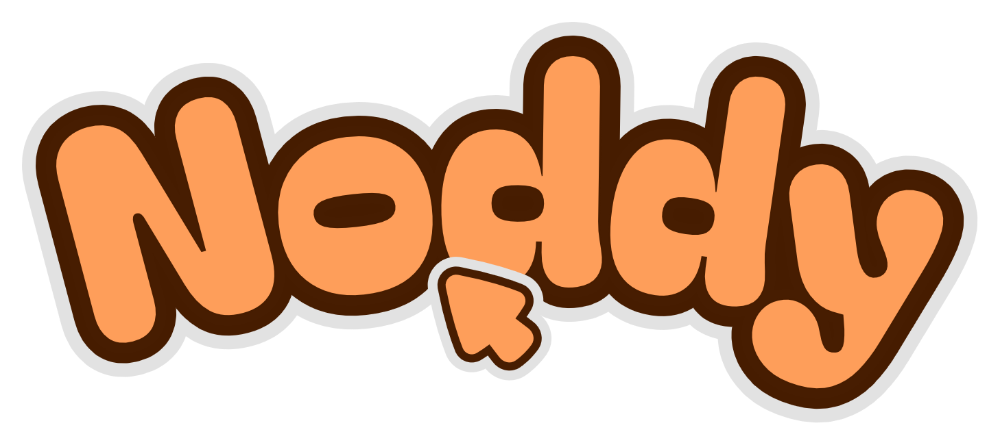
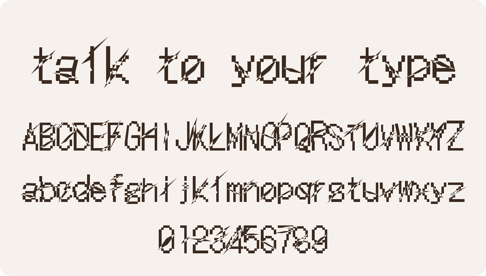

<p align="center">
  
</p>

<p align="center">
  An open-source agentic font editor. Talk to your type.
</p>

<p align="center">
  
</p>

Noddy is a browser font editor with an AI agent built in. The agent draws by calling the editor's own operations (no screen clicking), so you watch the font change live and can open any letter and fix it by hand with the pen tool. Everything the agent draws lands as a **Draft** until you press **Keep**.

Noddy is a fork of [Glyphr Studio 2](https://github.com/glyphr-studio/Glyphr-Studio-2).

> [!NOTE]
> Noddy is in development. Editing an existing font works best right now; other features are still rough.

## Features

- **Agent panel.** Ask for changes in plain words ("give every letter a slash like the A"). Big jobs stop for your approval after the first few control glyphs (n o H O).
- **Remix mode.** Style one letter yourself, and the agent carries that idea across the set with a different move on each glyph. Every take has a seed, so it can be reproduced or re-rolled.
- **Chaos tools.** Algorithmic effects with no AI: slash cut, glitch bands, warp, grid snap and Pixel Life. Seeded, previewed, and checked by a legibility guard.
- **Works with Claude Code.** Noddy runs a local MCP server, so Claude Code can drive the editor as its agent. Other models work through API keys (OpenAI, OpenCode Zen).
- **Glyphr Studio compatible.** Projects use the same `.gs2` format. Import and export OTF/TTF.

## Run it with Claude Code

Requirements: git, Node 22 or newer, and [Claude Code](https://claude.com/claude-code).

Paste this into Claude Code from any folder. It clones the repo, installs, starts Noddy, opens it in your browser and connects itself as the agent.

```text
Set up Noddy for me, one step at a time, and talk to me in plain words. Noddy is an open-source font editor with an AI agent, forked from Glyphr Studio 2.

1. Ask me which folder to save it in. Clone https://github.com/kshitij0299/noddy there with --branch dev.
2. Check that git and Node 22 or newer are installed. If not, tell me how to install them and wait for me.
3. Run npm ci in the clone.
4. Read .claude/commands/noddy.md in the clone and follow its steps 1 to 5. Start the dev server in the background. Use port 5300 unless it is busy. If it is busy, tell me and ask before using another free port (never 5187), then use that port everywhere the file says 5300. Run claude mcp add from the folder this chat started in, not from the clone.
5. Open Noddy in my browser and walk me through each click: open a project, press Local agent (the terminal button) in the agent panel, then type /mcp here and reconnect noddy.
6. Check the connection by calling get_context.

If any step fails, say sorry plainly, try to fix it, and tell me honestly if you can't.

When it works, say "You can start chatting with Noddy." Suggest I open an existing font and edit it, because the other features are still rough. Remind me that Noddy is still in development.
```

### Manual setup

```bash
git clone --branch dev https://github.com/kshitij0299/noddy.git
cd noddy
npm ci
npx vite serve ./src/ --port 5300 --strictPort
```

Open http://localhost:5300. To connect Claude Code, run `/noddy` from inside the clone ([`.claude/commands/noddy.md`](.claude/commands/noddy.md)). It fetches a pairing token, registers the `noddy` MCP server and opens the browser. Then turn on **Local agent** in the agent panel and reconnect `noddy` with `/mcp`.

The default branch, `main`, is an older version without the agent. Use `dev`.

## Made with Noddy

<picture>
  <source media="(prefers-color-scheme: dark)" srcset="docs/readme/slash-gothic-dark.svg">
  
</picture>

Slash Gothic, a remix of DotGothic16 (OFL). One hand-drawn 51° slash on the A, then Claude Code carried it across all 62 letters and figures over MCP.

## Docs

- [Product decisions](docs/agentic/PRODUCT.md)
- [Chaos tools](docs/agentic/CHAOS-TOOLS.md)
- [Remix mode](docs/agentic/REMIX-MODE.md)
- [Architecture](docs/agentic/ARCHITECTURE.md)
- [Launch plan](docs/agentic/plans/LAUNCH.md)

## Credits and license

Noddy is an independent fork of [Glyphr Studio 2](https://github.com/glyphr-studio/Glyphr-Studio-2) by Matt LaGrandeur and contributors, released under GPL-3.0-or-later. Noddy stays under the same license. See [NOTICE](NOTICE) for what changed and [LICENSE-gpl-3.0.txt](LICENSE-gpl-3.0.txt) for the full text.

Fonts you make with Noddy belong to you.
